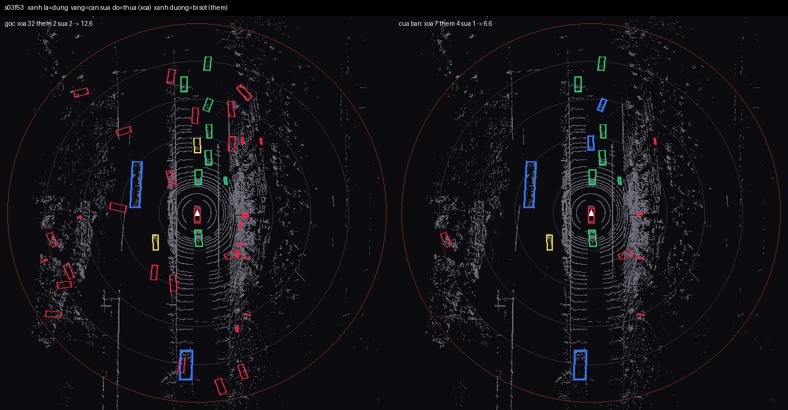

# Báo cáo Day 14 — Trịnh Đức Mạnh — 2A202603167

- Mã học viên dùng với `--student`: `2A202603167`
- `seed_tag` trong `frames_A.txt`: `393590736f`

## 1. Dự đoán trước sweep (bước 5b)

Ghi **trước** khi chạy `scripts/pp_sweep.py`, rồi commit và push ngay (lịch sử commit là bằng chứng thời điểm viết). Không sửa phần này sau khi có kết quả.

- Tham số tôi nghĩ giảm công sửa nhiều nhất: `score_thr`, tăng từ 0.1 (mặc định) lên khoảng 0.4.
- Vì sao (nhìn ảnh BEV tập A: box thừa nhiều hay box sót nhiều?): Trên BEV tập A tôi thấy box thừa nhiều hơn box sót. Theo số liệu `pred_A.json`, 53/104 box có score < 0.4, trong khi chỉ 8 box có dưới 10 điểm LiDAR, nên lọc theo `score_thr` sẽ tác động nhiều hơn `min_points`. Các box score thấp, nhất là Cyclist (16 box ở s01f54 và 12 box ở s03f53), phần lớn là box thừa; lúc sửa tôi phải xóa nhiều hơn thêm. Vì vậy tôi dự đoán tăng `score_thr` lên khoảng 0.4 sẽ giảm công sửa.

## 2. Tập A: sửa tay và tune

| Cấu hình | Xóa | Thêm | Sửa | Chi phí |
|---|---:|---:|---:|---:|
| Gốc | 61 | 9 | 4 | 29.3 |
| `best_config.json` | 15 | 16 | 3 | 22.0 |

- Tham số đã đổi trong `best_config.json`: `score_thr` 0.1 → 0.4 (`min_points` giữ 0; với `score_thr=0.4`, `min_points` = 0/5/10 cho cùng chi phí 22.0).
- Kết quả leave-one-out (dán các dòng `scripts/pp_sweep.py` in ra):

```
s01f54: cấu hình chọn {'score_thr': '0.4', 'min_points': '0'} → 12.8 (tốt nhất có thể 11.2)
s03f53: cấu hình chọn {'score_thr': '0.3', 'min_points': '10'} → 8.1 (tốt nhất có thể 6.4)
s04f31: cấu hình chọn {'score_thr': '0.3', 'min_points': '10'} → 3.2 (tốt nhất có thể 2.6)
```
- Cấu hình có ổn định trên từng frame không? Vì sao tôi vẫn chọn (hoặc không chọn) nó: ...

## 3. Trước/sau (bước 8)



| Frame | Chi phí gốc | `best_config.json` |
|---|---:|---:|
| s01f54 | 12.7 | 12.8 |
| s03f53 | 12.6 | 6.6 |
| s04f31 | 4.0 | 2.6 |
| **Tổng** | **29.3** | **22.0** |

- `scripts/pp_compare.py` báo giảm 25% công sửa trên tập A (3 frame, theo công thức chi phí của lab).
- Dự đoán ở mục 1 đúng hay sai? Giải thích bằng số box xóa/thêm/sửa: ...

## 4. Tập B

Số đo từ `scripts/pp_prelabel.py --frames d14_2A202603167/frames_B.txt --config d14_2A202603167/best_config.json --gt d14_2A202603167/ref_B.json`:

| Xóa | Thêm | Sửa | Chi phí |
|---:|---:|---:|---:|
| | | | |

- Loại box tốn công sửa nhất ở tập B: ...

## 5. Giới hạn

- ...
